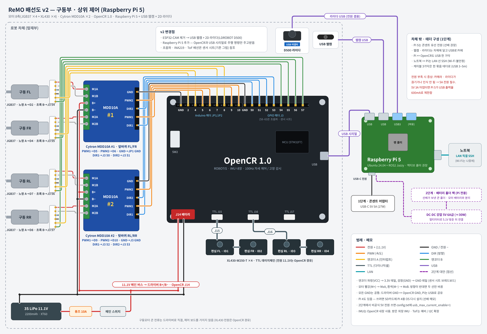

# ReMO (Resilient Mobility)

편심휠 고장 허용형 자세제어 모빌리티 — 세종대학교 기계공학과 종합설계 B, 팀 Fource

## 배선도

| 파일 | 내용 |
|---|---|
| `docs/wiring/ReMO_wiring_v2.png` / `.svg` | 구동부 + 상위 제어 (Raspberry Pi 5, USB 웹캠, 2D 라이다) |
| `docs/wiring/ReMO_wiring_v2.html` | 배선도 + 연결표 (브라우저로 열기) |
| `docs/wiring/ReMO_wiring_v1_sensors.png` | 센서 시트: HC-SR04 ×3, INA219 ×4 (ESP32-CAM은 v2에서 제거) |
| `docs/wiring/ReMO_wiring_v1_drive.png` | 구동 시트 v1: JGB37 ×4, MDD10A ×2, XL430 ×4 |

### 핀 배정 (v2)

| 부품 | 단자 | OpenCR |
|---|---|---|
| MDD10A #1 (앞 FL/FR) | PWM1 / PWM2 · DIR1 / DIR2 · GND | D5 / D6 · J3 50 / 51 · JP1 GND |
| MDD10A #2 (뒤 RL/RR) | PWM1 / PWM2 · DIR1 / DIR2 · GND | D9 / D10 · J3 52 / 53 · J3 GND |
| 엔코더 A FL / FR / RL / RR | 노랑 | D2 / D4 / D7 / D8 |
| 엔코더 B FL / FR / RL / RR | 초록 | J3 54 / 55 / 56 / 57 |
| XL430 ID1→ID2 / ID3→ID4 | TTL | J15 / J16 |
| Raspberry Pi 5 | USB | OpenCR micro-USB (시리얼) |

### 전원

- 3S LiPo 11.1V → 퓨즈 10A → 메인 스위치 → MDD10A ×2 (B+/B−), OpenCR J14 (XL430 전원 포함)
- Raspberry Pi 5는 모터 배터리와 분리
  - 1단계: 차체 밖에 두고 USB-C 5V 5A 어댑터로 전원 공급, 웹캠·라이다·OpenCR은 USB 테더로 연결, 노트북과는 LAN SSH
  - 2단계: 전용 배터리 홀더 팩 → 5V 6A급 강압 컨버터 → USB-C (`config.txt`에 `usb_max_current_enable=1`)

## 자율주행 (Raspberry Pi 5)

`software/` — 넘을 수 있는 턱은 편심 모드로 넘고, 못 넘는 장애물은 우회하는 v0.1. 하드웨어 없이 돌려 보는 시뮬레이션 포함. 자세한 내용은 [software/README.md](software/README.md).

## 펌웨어

| 경로 | 내용 |
|---|---|
| `firmware/motor1_test/` | 모터 1개 단품 테스트 (OpenCR + MDD10A + JGB37 엔코더) |

> `motor1_test.ino`는 단품 테스트용 배선(DIR → D6, 엔코더 B → D3)을 씁니다. v2 전체 배선(DIR1 → J3 50, 엔코더 B → J3 54)과 다르니, 차체에 조립한 상태로 돌릴 때는 코드 상단 핀 번호를 바꾸세요.
