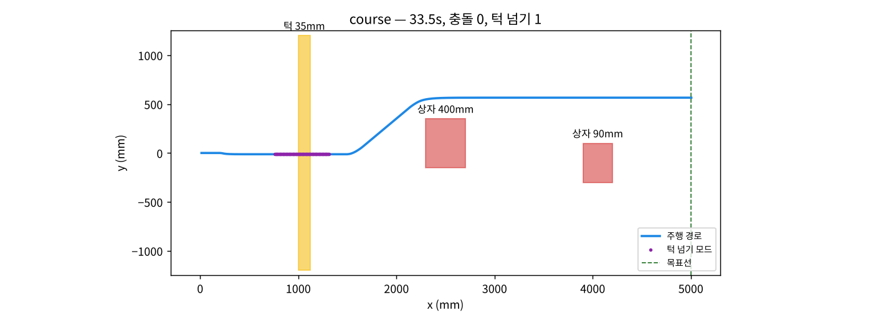

# ReMO 자율주행 v0.1 (Raspberry Pi 5)

넘을 수 있는 턱(≤ 50mm)은 편심 모드로 넘고, 못 넘는 장애물은 돌아간다.
센서 입력부터 OpenCR 주행 명령까지 한 번에 이어지는 파이프라인이고, 판단은 규칙 기반이다 (학습 모델 없음).

```
라이다 · ToF · 웹캠 · (OpenCR 경유) 초음파·IMU
        │
  perception.py   높이 게이트 + 단기 기억 → 정면이 clear / low / tall
        │
  planner.py      CRUISE · LOW_APPROACH · CLIMB · ESCAPE · STOP
        │
  opencr_link.py  $CMD,v,w,mode  →  OpenCR (100Hz 자세 제어 · 편심 시퀀스 · 고장 감시)
```

## 핵심 아이디어 — 높이 게이트

2D 라이다는 한 높이의 평면만 보므로 장애물 높이를 모른다. 그래서 센서를 높이별로 배치하고,
같은 장애물이 어느 센서에 잡히는지로 높이를 가른다.

| 센서 | 장착 | 보이는 것 | 역할 |
|---|---|---|---|
| 2D 라이다 (D500) | 차체 위, 지면 150mm | 150mm 넘는 것 | 키 큰 장애물 · 우회 방향 선택 |
| ToF | 앞 범퍼, **지면 50mm, 수평** | 50mm(넘을 수 있는 한계) 넘는 것 | "넘을 수 없음" 판정 |
| USB 웹캠 | 180mm, 30° 아래로 | 바닥이 아닌 모든 것 (높이 모름) | 낮은 턱까지 위치 · 폭 |
| 초음파 ×3 (OpenCR) | 범퍼 40mm | 40mm 넘는 것 | 보조 근접 감지 |

- 정면 중앙에 뭔가 있는데(카메라·초음파) ToF·라이다엔 안 잡힘 → **낮은 턱 → CLIMB**
- ToF나 라이다에 잡힘 → **넘을 수 없음 → 우회**
- ToF가 못 보는 통로 가장자리에만 있는 것 → 높이를 모르니 넘을 수 없다고 보고 우회 (보수적으로)

`climb_limit_mm: 50`은 편심량 e = 30mm의 이론 최대치 2e = 60mm에서 안전 여유를 뺀 값이다.
ToF 장착 높이(`tof.height_mm`)를 이 값과 같게 맞추는 것이 핵심이다.

**단기 기억:** ToF는 정면 한 줄만 보고, 카메라는 범퍼 앞 150mm 안이 사각지대다.
그래서 한 번 본 장애물은 이동 거리 추정으로 몇 초 동안 기억한다.
ToF가 잡은 점 근처의 카메라 점은 "넘을 수 없음"으로 승격해서 장애물 폭 전체를 기억한다.

## 시뮬레이션 (노트북에서 하드웨어 없이)

```bash
cd software
pip install -r requirements.txt
python3 -m remo_nav --sim course --plot course.png     # tall_box | low_step | mid_box | course
python3 -m pytest -q tests
```

| 시나리오 | 결과 |
|---|---|
| `tall_box` 300mm 상자 | 라이다로 보고 우회 |
| `low_step` 통로 전체를 막은 40mm 턱 | 턱 넘기 1회 |
| `mid_box` 80mm 상자 (라이다엔 안 보임) | ToF로 보고 우회 |
| `course` 35mm 턱 → 400mm 상자 → 90mm 상자 | 넘기 1 + 우회 |



## 로봇에서 실행 (Pi 5)

1. 배선: `docs/wiring/ReMO_wiring_v2.png`. ToF는 Pi I2C에 연결한다: 1번 3.3V, 3번 SDA, 5번 SCL, 6번 GND
2. I2C 켜기 (Raspberry Pi OS: `sudo raspi-config` → Interface → I2C), `i2cdetect -y 1`로 ToF 주소(0x29) 확인
3. 장치 이름 확인: 라이다 `/dev/ttyUSB0`, OpenCR `/dev/ttyACM0`, 웹캠 `/dev/video0` → 다르면 `config.yaml` 수정
4. `config.yaml`의 `TODO 실측`(차체 폭·길이)과 센서 장착 위치·높이를 실제 값으로 바꾸기
5. 바퀴를 띄운 상태로 먼저 실행해 상태 출력 확인 → 바닥에서 실행

```bash
pip install -r requirements.txt --break-system-packages
./run_robot.sh                 # Ctrl+C 정지, 주행 로그는 logs/run_*.csv
```

ROS2 없이 순수 Python으로 돈다. 나중에 SLAM · 경로계획이 필요하면 ROS2(Jazzy)로 옮긴다.

## OpenCR 쪽에서 구현할 것 (프로토콜)

ASCII 한 줄, 115200 baud. `XX`는 `$`와 `*` 사이 문자의 XOR (16진수 2자리).

```
Pi → OpenCR (15Hz)   $CMD,<v mm/s>,<w mrad/s>,<mode>*XX
                     mode 0 = 일반 주행, 1 = 턱 넘기 요청, 2 = 정지
OpenCR → Pi (20Hz)   $STA,<mode>,<fault_mask>,<roll cdeg>,<pitch cdeg>,<yaw cdeg>,<us_l>,<us_c>,<us_r>*XX
                     mode = 실제 수행 중 모드 (턱 넘기 시퀀스가 끝나면 0으로 복귀)
                     fault_mask bit0~3 = FL, FR, RL, RR 바퀴 고장 / 초음파 mm, 실패 0
```

- `v`, `w` → 스키드 조향: 왼쪽 = v − w·B/2, 오른쪽 = v + w·B/2 (B = 좌우 바퀴 간격)
- mode 1을 받으면 OpenCR가 편심 턱 넘기 시퀀스(접촉 감지 → 앞바퀴 들기 → 전진 → 뒷바퀴)를 수행하고, 끝나면 `$STA`의 mode를 0으로 돌린다
- **워치독:** 0.5초 동안 `$CMD`가 안 오면 스스로 정지
- 바퀴 고장(fault_mask ≠ 0)이면 Pi는 속도를 80mm/s로 제한하고 턱 넘기를 시도하지 않는다

## 파일

| 파일 | 내용 |
|---|---|
| `config.yaml` | 모든 파라미터 (치수 · 속도 · 거리 임계값 · 센서 장착 위치) |
| `remo_nav/lidar_ld19.py` | D500(LD19) 패킷 파서 (CRC8 검증) |
| `remo_nav/tof.py` | VL53L0X / VL53L1X |
| `remo_nav/vision.py` | 웹캠 바닥 색 분할 → 띠별 장애물 거리 |
| `remo_nav/opencr_link.py` | OpenCR 시리얼 프로토콜 |
| `remo_nav/perception.py` | 높이 게이트 · 단기 기억 · 정면 판정 |
| `remo_nav/planner.py` | 상태 기계 · 반응형 방향 선택 |
| `remo_nav/sim.py` | 2D 시뮬레이터 (높이 있는 장애물, OpenCR 흉내) |

## 한계 (v0.1)

- 목표는 "출발 방향 유지"다. 우회한 뒤 원래 직선으로 복귀하지는 않는다
- 위치 추정은 명령 속도 + IMU yaw 적분이다. OpenCR가 엔코더 오도메트리를 `$STA`에 추가하면 정확해진다
- 카메라 바닥 분할은 단색 바닥 · 고른 조명을 가정한다. 무늬 있는 바닥에서는 `floor_thresh` 튜닝이 필요하다
- 낮은 턱 옆에 붙은 50~150mm 장애물은 ToF 빔 밖이면 높이를 놓칠 수 있다
